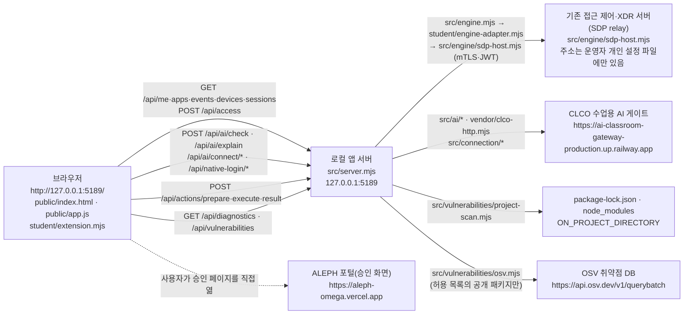

# 1q2w3e4r! 학생 실행 설명서와 시스템 구성도

이 문서는 학생이 작성했습니다. 내 보안 Agent 「1q2w3e4r!」(시작 틀 이름은 케셰브)를 다른 사람이 같은 순서로 실행하고, 구성과 장애 원인을 확인할 수 있게 정리했습니다.
제공 문서(`README.md`, `docs/STUDENT_LAUNCH_GUIDE.md`, `docs/CONNECTION_TROUBLESHOOT.md` 등)는 고치지 않았습니다. 이 문서는 그 문서들과 실제 코드를 대조해 쓴 학생 문서입니다.

표기 원칙

- **코드 확인**: 저장소의 실제 파일을 읽고 확인한 내용입니다.
- **모의 점검**: 학생 함수에 모의 입력을 넣어 화면 글자를 확인한 내용입니다(실제 서버·계정 연결 아님).
- **실행 확인**: 학생 PC에서 직접 실행해 확인한 내용입니다.
- **미확인 / 기다림(UNV)**: 아직 실행해 보지 않았거나, 운영자 준비가 끝나지 않아 확인할 수 없는 내용입니다. 확인된 것처럼 쓰지 않습니다.
- 열쇠·토큰·비밀번호·개인 설정 파일 내용은 이 문서에 적지 않습니다.

---

## 1. 필요 프로그램과 버전

| 항목 | 요구 값 | 근거(코드 확인) | 학생 PC 확인 값 |
|---|---|---|---|
| 운영체제 | Windows + PowerShell | `tools/start-alekov.ps1`이 `C:\Windows\System32\WindowsPowerShell\v1.0\powershell.exe`와 Windows 사용자 폴더를 사용 | 미확인 |
| Node.js | 22~24, 수업 기준 **24.19.0** | `package.json`의 `engines.node: 24.19.0`, 실행 도구가 22 미만·24 초과면 중단 | 미확인 (`node -v` 결과를 적으세요) |
| npm 의존성 | 없음(0개) | `package.json`에 `dependencies` 없음. 그래서 `package-lock.json`도 없음 | 해당 없음 |
| 브라우저 | PC 브라우저, 창 너비 1280px 이상 권장 | 13단계 확인 안내 | 미확인 |
| 앱 버전 | `alekov-client-starter` **0.2.14** | `package.json`의 `version` (폴더 이름은 `alekov-starter-0.2.11`) | 해당 없음 |

macOS·Linux에서는 실행 도구(`.ps1`)를 쓸 수 없습니다. 이 환경은 지원 범위로 확인하지 않았습니다.

## 2. 폴더 구조

GitHub 저장소 `lley01/defent_agent` 기준입니다(코드 확인).

```text
defent_agent/                         ← Git 최상위 폴더. 커밋·제출 준비는 여기서 합니다.
└─ alekov-starter-0.2.11/
   ├─ README.md                       ← 학생 README(목적·기능·구성·지원 환경)
   └─ on-client/                      ← 앱 폴더. 실행 명령은 여기서 합니다.
      ├─ package.json                 ← 이름·버전·실행 스크립트
      ├─ .env.example                 ← 비밀 없는 설정 견본(ON_PORT 등)
      ├─ .on-starter-manifest.json    ← 제공 파일 목록(manifest)
      ├─ tools/start-alekov.ps1       ← 실행 도구(Node 버전·포트 확인 후 서버 실행)
      ├─ src/server.mjs               ← 로컬 앱 서버
      ├─ src/engine.mjs, src/engine/  ← 기존 접근 제어·XDR 서버(SDP) 연결
      ├─ src/ai/, vendor/clco-http.mjs← CLCO 수업용 AI 게이트 연결
      ├─ src/connection/              ← 계정 연결 확인(native login)
      ├─ src/actions/                 ← 조치 준비·집행·결과 조회
      ├─ src/vulnerabilities/         ← package-lock 대조·OSV 조회
      ├─ public/                      ← 브라우저 화면(index.html, app.js 등)
      ├─ student/extension.mjs        ← 학생 구현 함수 8개
      ├─ student/engine-adapter.mjs   ← 엔진 연결 어댑터(제공 파일, 수정 안 함)
      └─ docs/                        ← 제공 문서 + 이 문서(STUDENT_RUNBOOK.md)
```

내 PC에서는 Git 최상위 폴더가 다른 경로에 있을 수 있습니다. `git rev-parse --show-toplevel`로 확인합니다.

## 3. 실행 절차

모든 명령은 실행 도구와 제공 안내(`docs/STUDENT_LAUNCH_GUIDE.md`)의 코드에서 확인한 것입니다. 학생 PC에서의 실행 결과는 7장의 확인 기록에 따로 적습니다.

### 3-1. PowerShell 여는 위치

1. 파일 탐색기에서 앱 폴더 `alekov-starter-0.2.11\on-client`를 엽니다.
2. 주소 표시줄에 `powershell`을 입력하고 Enter를 누릅니다.
3. 열린 창에서 아래 명령으로 위치를 확인합니다. `package.json`과 `tools`가 보이면 앱 폴더입니다.

```powershell
Get-ChildItem
```

### 3-2. 실행

```powershell
powershell -NoProfile -ExecutionPolicy Bypass -File .\tools\start-alekov.ps1
```

- `-ExecutionPolicy Bypass`는 이번 실행에만 적용되며 PC 설정을 바꾸지 않습니다.
- `-Demo`(예제 자료)와 `-NoNativeHost`(계정 연결 없음)는 실제 연결 확인에 쓰지 않습니다.
- 운영자가 SDP 개인 설정 파일을 안내한 경우에만 `-SdpHostConfig "<안내받은 절대 경로>"`를 덧붙입니다. 경로와 파일 내용은 문서·Git에 남기지 않습니다.
- `npm start`도 같은 서버(`node src/server.mjs`)를 켜지만, 계정 연결 설정을 넘기지 않아 계정 연결이 `NATIVE_HOST_DISABLED`가 됩니다.

### 3-3. 정상 시작 신호

실행 도구가 아래 두 줄을 출력하면 서버가 응답한 것입니다(`tools/start-alekov.ps1` 코드 확인).

```text
케셰브가 켜졌습니다. 브라우저에서 http://127.0.0.1:5189/ 을 여세요.
서버가 응답한 것만 확인했습니다. AI 연결 상태는 화면에서 따로 확인해 주세요.
```

이 신호는 서버가 켜졌다는 뜻일 뿐, 계정·AI·SDP 연결 성공이 아닙니다.

### 3-4. 브라우저 주소

`http://127.0.0.1:5189/` 를 엽니다. 서버는 `127.0.0.1`에서만 요청을 받습니다(`src/server.mjs`의 `server.listen(port,'127.0.0.1')`). 위쪽 데이터 상태 표시와 「보호 현황」 화면이 보이면 화면이 열린 것입니다.

### 3-5. 종료와 재실행

| 동작 | 방법 |
|---|---|
| 종료 | 실행한 PowerShell 창에서 `Ctrl+C`. 브라우저 주소가 더 열리지 않으면 종료된 것입니다. |
| 창 없이 실행했을 때 종료 | `-Background`로 켰다면 안내된 프로세스 번호의 `node`를 작업 관리자에서 종료합니다. |
| 재실행 | 같은 앱 폴더에서 3-2의 명령을 다시 실행합니다. 실행·종료는 학생 파일을 바꾸지 않습니다. |
| 코드 수정 반영 | `student/extension.mjs`를 고친 뒤 브라우저를 새로고침합니다. 서버 코드를 바꾸지 않았다면 서버를 다시 켤 필요는 없습니다. |
| 문법 확인 | `npm run check` (`node --check student/extension.mjs`, 문법만 확인) |

## 4. 시스템 구성도

### 4-1. Mermaid



### 4-2. 같은 내용을 글로 쓴 표

| 상자 | 실제 파일·주소(코드 확인) | 하는 일 | 다음 상자 |
|---|---|---|---|
| 브라우저 | `http://127.0.0.1:5189/`, `public/index.html`, `public/app.js`, `student/extension.mjs` | 화면 표시. 제공 화면이 응답 형식을 검사한 뒤 학생 함수에 값을 넘김 | 로컬 앱 서버 |
| 로컬 앱 서버 | `src/server.mjs` (`127.0.0.1:5189`, `ON_PORT`로 변경 가능) | `/api/*` 요청 처리. 다른 출처 요청·허용되지 않은 Host 거절 | SDP, CLCO, OSV, lock 파일 |
| 기존 접근 제어·XDR 서버(SDP) | `src/engine.mjs`, `student/engine-adapter.mjs`, `src/engine/sdp-host.mjs`, `src/engine/sdp-host-config.mjs` | 본인 로그인·기기·세션, 업무 앱 목록, 접근 판정(allow/deny/challenge/unknown), 본인 접속 기록과 저장된 XDR 경보 | (응답) |
| CLCO 수업용 AI 게이트 | `https://ai-classroom-gateway-production.up.railway.app` (`src/ai/connection.mjs`), 앱 경로 `/api/apps/aleph-on/v1` | 계정 연결 확인, AI 앱 승인, 모델 응답 점검, 사건 설명 | (응답) |
| ALEPH 포털 | `https://aleph-omega.vercel.app` (`src/ai/connection.mjs`) | 사용자가 확인 번호를 보고 승인하는 화면. 서버가 대신 승인하지 않음 | — |
| OSV | `https://api.osv.dev/v1/querybatch` (`public/vulnerabilities-view.mjs`, `src/vulnerabilities/osv.mjs`) | 허용 목록의 공개 패키지 정확한 버전으로 알려진 취약점 조회 | (응답) |
| package-lock·node_modules | `ON_PROJECT_DIRECTORY` 설정 경로 (`src/vulnerabilities/project-scan.mjs`) | 설치된 정확한 버전과 lockfileHash 계산 | OSV |

### 4-3. ASCII 요약

```text
[브라우저 127.0.0.1:5189]
   │  /api/*
   ▼
[로컬 앱 서버 src/server.mjs]
   ├─▶ [SDP relay: 접근 제어·XDR]  src/engine/sdp-host.mjs  (주소: 운영자 설정 파일, 문서에 적지 않음)
   ├─▶ [CLCO 수업용 AI 게이트]      https://ai-classroom-gateway-production.up.railway.app
   ├─▶ [package-lock·node_modules]  ON_PROJECT_DIRECTORY
   └─▶ [OSV]                        https://api.osv.dev/v1/querybatch
[브라우저] ┄┄▶ [ALEPH 포털 승인 화면] https://aleph-omega.vercel.app (사용자가 직접 엶)
```

연결 설정(코드 확인): 실행 도구는 `.env`를 읽지 않습니다. `ON_ENGINE_ADAPTER`가 없고 `-SdpHostConfig`도 없으면 엔진은 연결 없음(`disconnected`) 상태로 켜집니다.

## 5. 제공 부분과 학생 작성 부분

### 5-1. 경계

| 구분 | 파일 | 비고 |
|---|---|---|
| 제공(수정 안 함) | `.on-starter-manifest.json`에 적힌 파일 전체: `src/**`, `public/**`, `tools/**`, `vendor/**`, `docs/`의 제공 문서, `package.json`, `.env.example`, `README.md`, `student/engine-adapter.mjs` | 서버·제공 화면·판정·인증 코드는 바꾸지 않았습니다. |
| 학생 작성 | `student/extension.mjs` | 13~20단계 함수 8개를 구현했습니다. 시작 틀의 `student/extension.mjs`는 대기 문구만 반환했습니다. |
| 학생 작성 | `docs/STUDENT_RUNBOOK.md`(이 문서), `../README.md`(학생 README) | 21단계 문서 |

학생 함수는 제공 화면(`public/app.js`)이 호출합니다. 학생 함수는 DOM 요소 하나를 반환하고, 제공 화면이 해당 칸 내용을 그 요소로 교체합니다. 학생 함수는 서버에 요청을 보내지 않고 `innerHTML`을 쓰지 않습니다(`createElement`·`textContent`만 사용).

### 5-2. 구현한 함수

| 단계 | 함수 | 화면 칸 | 보여 주는 것 |
|---|---|---|---|
| 13 | `renderIdentity` | 보호 현황 · 학생 구현 표시 | 로그인 사용자·현재 기기·세션과 등록 기기·세션 목록. loading/ok/error를 나누고, 오류 시 이전 사용자 이름을 지웁니다. noncompliant·expired·revoked는 「주의」로 표시합니다. |
| 14 | `renderDecision` | 업무 앱 · 학생 구현 표시 | 접근 허용(allow)·접근 거부(deny)·추가 확인 필요(challenge)·판정 확인 불가(unknown)와 판정 이유·시각. 요청 실패는 거부 판정과 따로 표시합니다. |
| 15 | `renderEvents` | 보안 기록 · 학생 구현 표시 | 최신순 기록 목록, 「기록 종류」「업무 앱」「접속 상태」 필터, 「<event.id> 상세」의 근거·규칙·세 상태. 빈 목록과 조회 실패를 다르게 표시합니다. |
| 16 | `renderStatus` (+ 15단계 상세) | 보호 현황 · 학생 상태·알림 표시 | 기기·세션의 불러오는 중/빈 목록/실패, 알림(resource·code·message), 도움정보 6개 값과 「도움정보 복사」 버튼. 미지원 조치가 넘어오면 상세 안에 「<action> 미지원」 비활성 버튼을 둡니다. |
| 17 | `renderAiConnection` | 보호 현황 · 학생 AI 연결 표시 | AI 연결 점검 전·점검 중·test/verified 결과(모델 수·점검 시각)와 원인별 오류 안내. "사건 설명은 아직 실행하지 않았습니다"를 명시합니다. |
| 18 | `renderExplanation` | 보안 기록 · 학생 AI 사건 설명 | 사건 ID·AI 설명(참고용)·인용한 근거·규칙·확인 불가 상태·제안(미실행). 근거가 맞지 않으면 설명을 쓰지 않습니다. |
| 19 | `renderAction` | 보안 기록 · 학생 조치 상태 표시 | idle~expired 11개 상태를 구분합니다. ACK(pending)는 효과가 아니며, `effectApplied:true`일 때만 효과 확인으로 표시합니다. 버튼·요청 없음. |
| 20 | `renderVulnerabilities` | 보호 현황 · 학생 패키지 조회 표시 | 전체 조회 상태 5종, lockfileVersion·lockfileHash, 패키지별 정확한 설치 버전·상태·취약점 ID와 수정 시각. 미조회·실패를 "취약점 없음"으로 쓰지 않습니다. |

## 6. 장애 안내

화면·실행 창에 실제로 나오는 문구는 코드에서 확인했습니다. 학생 칸 문구는 `student/extension.mjs`, 제공 칸 문구는 `public/app.js`·`public/ai-connect.mjs`, 실행 창 문구는 `tools/start-alekov.ps1`에 있습니다.

| 상황 | 화면·실행 창 문구(코드 확인) | 원인 | 확인·복구 순서 |
|---|---|---|---|
| Node.js 없음 | `Node.js 가 없습니다. https://nodejs.org 에서 Node.js 24.19.0(LTS)을 설치한 뒤 새 PowerShell 창에서 다시 실행해 주세요.` | Node 미설치 | Node.js 24.19.0 설치 → 새 PowerShell 창 → 3-2 실행 |
| Node 버전 범위 밖 | `지금 Node.js 는 vXX 입니다. 앱은 Node.js 22~24 에서 실행합니다. …` | 22 미만·24 초과 | `node -v` 확인 → 24.19.0 설치 |
| 포트 사용 중 | `포트 5189 를 다른 프로그램이 쓰고 있습니다. … 예: -Port 5190` | 다른 프로그램이 5189 사용 | 그 프로그램은 두고 `-Port 5190`으로 실행, 브라우저도 5190으로 열기 |
| 서버가 늦게 뜸 | `앱 서버가 20 초 안에 뜨지 않았습니다. 이 창의 메시지를 담당 강사에게 보여 주세요.` | 서버 시작 실패·지연 | 창의 메시지 전체를 강사에게 전달 |
| 앱 폴더가 아님 | `앱 폴더가 아닙니다. 받은 시작 틀의 on-client 폴더 안에서 …` | 다른 폴더에서 실행 | 3-1로 위치 확인 |
| 계정 연결 기능 꺼짐 | `이 PC의 앱 서버에서 계정 연결 기능이 준비되지 않았습니다. 기존 설명·판정·기록은 그대로 쓸 수 있습니다.` (`NATIVE_HOST_DISABLED`) | `npm start`·`-Demo`·`-NoNativeHost`로 실행 | 서버 종료 → 3-2 실행 도구로 옵션 없이 다시 실행 |
| 계정 연결 결과 확인 불가 | `서버 결과를 확인할 수 없습니다(확인 불가). 연결로 보지 않습니다.` 등 `NATIVE_*_UNVERIFIED`·`OUTCOME_UNKNOWN` | 포털 승인 결과를 서버가 확인하지 못함 | 「현재 로그인 확인」 한 번 → 안 되면 「계정 연결 취소」 → 「계정 연결 시작」으로 새로 시작 → 계속되면 도움정보와 함께 담당자에게 |
| 기존 서버 연결 없음 | 학생 칸: `연결 실패: 기존 서버·에이전트의 연결을 확인할 수 없습니다. 연결 어댑터를 먼저 확인하세요.` + `데이터 상태: 연결 없음` (`ENGINE_NOT_CONNECTED`) | SDP 설정 없이 실행(기본) | 운영자가 SDP 개인 설정을 안내하면 `-SdpHostConfig`로 실행. 그 전에는 정상적인 미연결 상태 |
| 응답 형식 확인 불가 | `서버 응답 형식을 확인할 수 없습니다(확인 불가). 정상으로 간주하지 마세요.` 학생 칸은 `확인 불가: …` (`CONTRACT_MISMATCH`) | 응답이 계약과 다름 | 정상·빈 목록으로 보지 않음. 「다시 불러오기」 한 번 → 계속되면 도움정보를 담당자에게 |
| 로컬 서버 꺼짐 | `로컬 서버에 연결할 수 없습니다.` (`NETWORK_ERROR`) | 서버 종료됨 | 실행 창 확인 → 3-2 재실행 → 「다시 불러오기」 직접 누르기 |
| 시간 초과 | `서버 응답 시간이 초과됐습니다. 필요하면 직접 다시 요청하세요.` 학생 상태 칸은 `시간 초과 · …` | 응답 지연 | 잠시 뒤 「다시 불러오기」를 직접 누름(자동 재요청 없음) |
| AI 권한 준비 중 | 학생 AI 칸: `AI 연결 점검 실패 · 원인: 권한 준비 중` (`ON_AI_PROVISIONING_PENDING`) | 운영자의 앱 권한 발급·게이트 반영 전 | 계정 연결·AI 앱 승인을 마쳤는지 확인 → 담당자 확인. 학생 잘못이 아닐 수 있음 |
| AI 모델 없음 | `원인: 쓸 수 있는 모델 없음` (`ON_AI_MODEL_LIST_EMPTY`) | 모델 허용 설정 없음 | 담당자에게 모델 허용 설정 확인 요청 |
| AI 설명 실패 | 학생 설명 칸: `AI 설명 실패: <message>` + `기록은 그대로입니다.` | 권한·근거 불일치(`ON_AI_INVALID_OUTPUT`) 등 | 기록·판정은 계속 사용 가능. 유료 요청을 반복하지 않음 |
| 패키지 조회 미설정 | `전체 조회 상태: 조회 준비 미완료(not_configured)` / `아직 조회 안 함(not_checked)` | `ON_PROJECT_DIRECTORY`·허용 목록 비어 있음 | 운영자 준비 사항. 취약점 없음이 아님. 학생이 설정을 임의로 바꾸지 않음 |
| 패키지 조회 실패 | `조회 실패: <message>` | 취소·시간 초과·서비스 오류 | 「설치 패키지 조회」를 직접 다시 누름 |

자세한 오류 코드 표는 제공 문서 `docs/CONNECTION_TROUBLESHOOT.md`를 봅니다.

## 7. 확인 기록과 지원 범위

### 7-1. 확인한 것

| 항목 | 확인 방법 | 결과 |
|---|---|---|
| 실행 명령·정상 시작 문구·포트·종료 방법 | 코드 확인(`tools/start-alekov.ps1`, `package.json`, `src/server.mjs`) | 이 문서 3장과 일치 |
| 학생 함수 8개의 상태별 화면 글자 | 모의 점검(jsdom 모의 입력, 요청 전송 0회) | 단계별 점검 통과. 실제 서버 응답 아님 |
| 실행 도구로 앱 실행 | 실행 확인 | 미확인 (학생 PC에서 실행 후 기입) |
| 학생 PC Node.js 버전 | 실행 확인(`node -v`) | 미확인 (기입) |
| 화면 3메뉴 이동(마우스·Tab·Enter) | 실행 확인 | 미확인 (기입) |

### 7-2. 기다림(UNV)·미확인 목록

아래는 실제로 확인하지 못했습니다. 연결 성공으로 적지 않습니다.

| 기능 | 상태 | 이유 |
|---|---|---|
| 계정 연결 확인(native login) | 기다림(UNV) | 실행해 본 결과 `NATIVE_HOST_DISABLED`(옵션 없는 실행), 이후 포털에서 "확인 결과를 알 수 없습니다" 안내를 받음. 연결 완료를 확인하지 못함 |
| AI 앱 승인·모델 응답 점검(verified) | 기다림(UNV) | 계정 연결이 확인되지 않음 |
| 실제 AI 사건 설명 | 기다림(UNV) | 17단계 권한 준비 전 |
| SDP 실제 로그인·기기·세션·기록·업무 앱 판정 | 미확인 | SDP 개인 설정을 안내받지 않아 연결 없음 상태로만 실행 가능 |
| 보안 조치 집행·결과 재조회 | 기다림(UNV) | 현재 기록의 `supportedActions`가 비어 있어 실제 처리 경로가 열리지 않음 |
| OSV 실제 조회 결과 | 미확인 | 허용 목록이 비어 있으면 not_configured·not_checked가 정상 |
| macOS·Linux 실행 | 지원 범위 밖 | 실행 도구가 Windows PowerShell 전용 |

OSV에 알려진 항목이 없다는 결과만으로 패키지나 앱이 안전하다고 보장하지 않습니다. AI 설명과 제안은 참고 정보이며, 설명만으로 보안 조치가 실행되지 않습니다.
